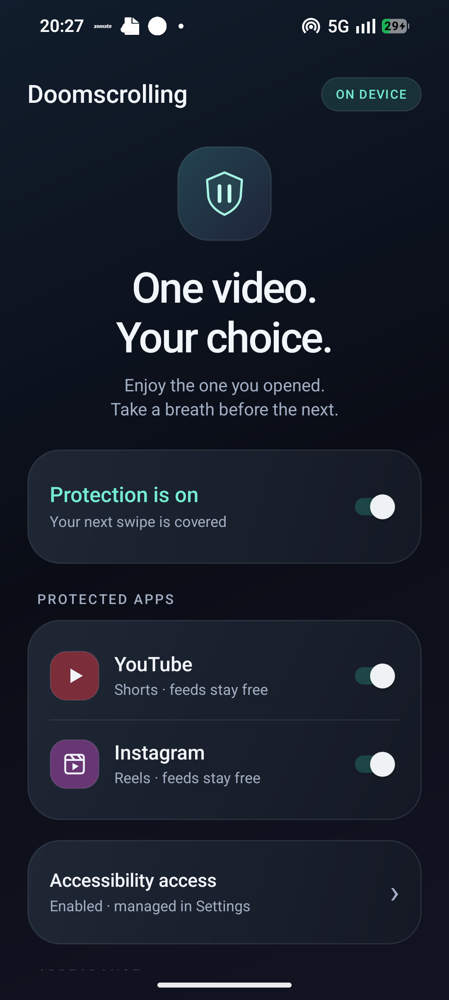

# Doomscrolling 🛡️

[](https://www.gnu.org/licenses/agpl-3.0)
[](https://developer.android.com)
[](https://www.rust-lang.org/)
[](https://vercel.com)

**One video. Your choice.**

Doomscrolling is a free, open-source Android application powered by an in-memory Rust engine. It allows you to watch the YouTube Short or Instagram Reel you explicitly chose to open, but immediately intercepts vertical swipes into subsequent videos—breaking the addictive infinite-scroll loop before the algorithm takes control.

On an intercepted swipe, the current video keeps playing seamlessly while a clean reminder appears:
> **"You are doom scrolling"**

Ordinary feeds, comments sheets, playback toggles, and system gestures remain completely usable.

---

## ✨ Features

- **Watch Intentionally**: Open any Short or Reel from search, shared links, feeds, or tabs—it plays without restriction.
- **Swipe-Interception**: The moment you attempt to swipe to the next video, the swipe is consumed before the next video loads.
- **Unbroken Feeds & Comments**: Home feeds, search results, profiles, comment bottom-sheets, and system navigation stay fully interactive.
- **Sleek iOS Tahoe Dark Theme**: Translucent frosted-glass surfaces, rounded corners, responsive typography, and system bar integration.
- **Privacy First (100% On-Device)**:
  - Zero internet permissions in the Android app.
  - UI snapshots are analyzed transiently in RAM by the Rust engine; no text or history is saved or transmitted.
  - No accounts, ads, trackers, or telemetry.

---

## 📱 Screenshots

<div align="center">
  
</div>

---

## 🚀 Installation

1. **Download APK**:
   - Download [`Doomscrolling-v0.1.0.apk`](https://github.com/neonjava/doomscrolling/releases/download/v0.1.0/Doomscrolling-v0.1.0.apk) from GitHub Releases or directly from the [Doomscrolling Webpage](https://doomscrolling.vercel.app).
2. **Install**:
   - Tap the APK on your Android device. If prompted, grant permission to install from your browser.
3. **Enable Accessibility Access**:
   - Open Doomscrolling and tap **Accessibility access**.
   - Turn on **Doomscrolling** in Android Settings.
   - *(If Android 13+ displays "Restricted setting": Go to Phone Settings → Apps → Doomscrolling → tap the 3 dots in the top right → Allow restricted settings).*
4. **Choose Apps**:
   - Toggle YouTube Shorts and/or Instagram Reels protection.

---

## 🌐 Webpage & Vercel Deployment

This repository includes a production-ready website (`web/`) with dark iOS Tahoe aesthetics, clean routing, an interactive simulator, and direct APK download.

### Deploying to Vercel in 1-Click:
1. Push your repository to GitHub.
2. Import the repository in [Vercel](https://vercel.com).
3. The included `vercel.json` automatically configures:
   - Output directory: `web/`
   - Clean URLs (e.g., `/open-source`, `/privacy`, `/download`)
   - Strict security headers (CSP, HSTS, Permissions Policy).
4. Deploy!

### Local Development
```bash
# Run local preview server with clean URL support
python3 scripts/serve_web.py 3000
# Or
npm run dev
```

---

## 🛠️ Architecture

```
┌────────────────────────────────────────────────────────┐
│                    Android Host Layer                  │
│                                                        │
│  MainActivity (Settings UI)   ProtectionService (A11y) │
│           │                             │              │
│           │                             ▼              │
│           │                     Accessibility Overlay  │
│           ▼                             │              │
│     SharedPreferences                   ▼              │
│           │                        Touch Events        │
└───────────┼─────────────────────────────┼──────────────┘
            │                             │
            │           JNI Boundary      │
            ▼                             ▼
┌────────────────────────────────────────────────────────┐
│                    Rust Core Engine                    │
│                                                        │
│  - Bounded Snapshot Parser (SERDE JSON)                │
│  - Target Classifier (YouTube Shorts / IG Reels)       │
│  - Viewport Coordinate Trimmer (Preserves Comments)    │
│  - Gesture State Machine (Forward Taps, Block Swipes)  │
│  - Anti-Spam Warning Rate Limiter                      │
└────────────────────────────────────────────────────────┘
```

See [docs/ARCHITECTURE.md](docs/ARCHITECTURE.md) and [docs/PLAN.md](docs/PLAN.md) for full engineering specifications.

---

## 🧪 Verification & Testing

Tested on physical hardware:
- **Device**: Nothing Phone (2a) / PacmanPro (Android 16, ARM64)
- **Target Apps Tested**:
  - YouTube v21.42.243 / v20.38.37
  - Instagram v452.0.0.48.64

Run automated suites:
```bash
# Rust core unit tests & lints
cargo fmt --check
cargo clippy --locked --all-targets -- -D warnings
cargo test --locked

# Android verification & linting
./gradlew :app:lintDebug :app:assembleDebug :app:assembleDebugAndroidTest
```

---

## 📄 License

This program is free software: licensed under the **GNU Affero General Public License v3.0 (AGPL-3.0-only)**. See [LICENSE](LICENSE).
